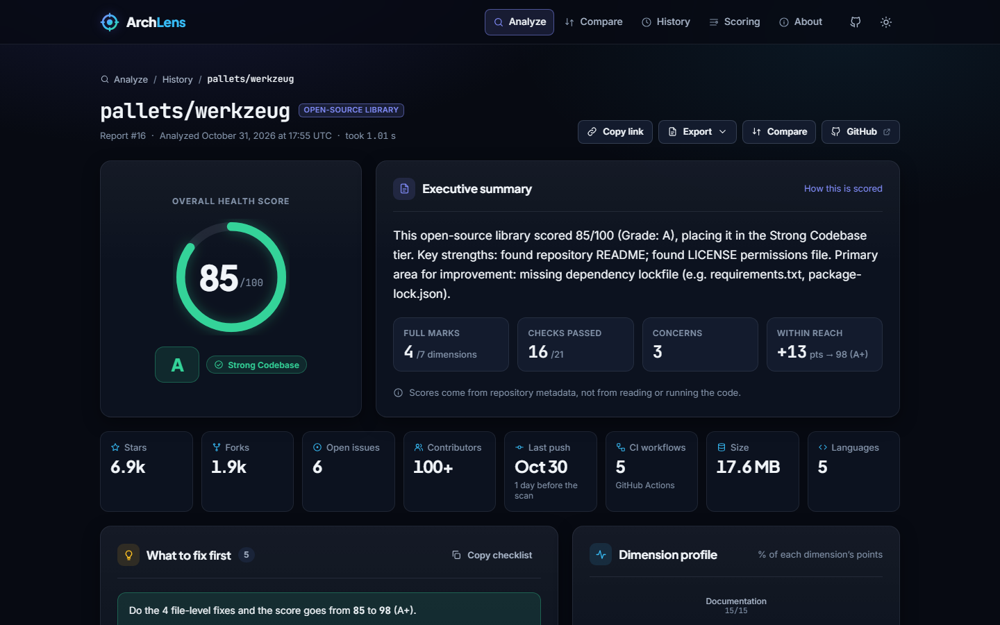
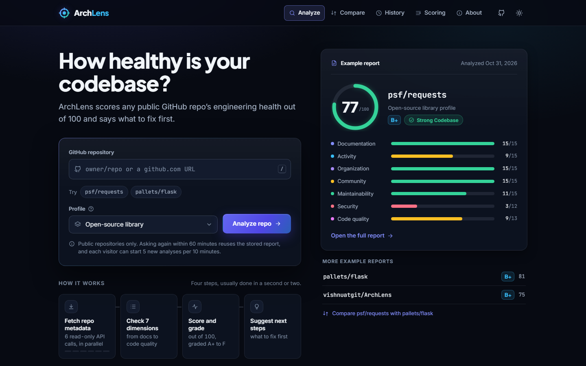
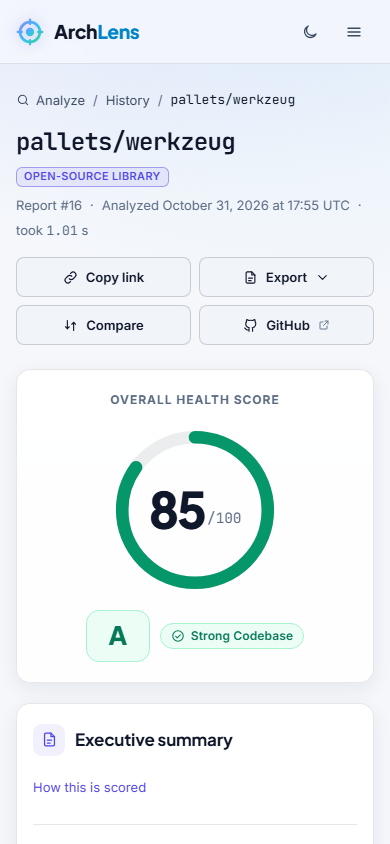
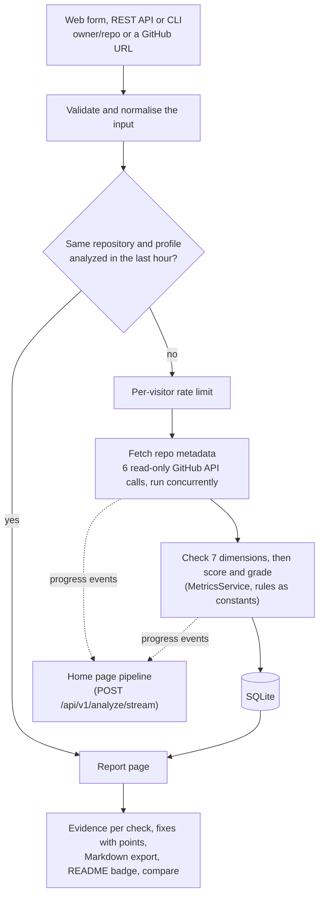

# ArchLens

**Scores any public GitHub repo's engineering health out of 100 and says what to fix first.**

A FastAPI web app, REST API and CLI. It reads a repository's metadata through the GitHub REST API (it never clones code), scores it across seven dimensions, explains every point, and stores every new analysis in SQLite so reports can be revisited, compared and shared.

[](https://github.com/vishnuatgit/ArchLens/actions/workflows/ci.yml)


**Live demo:** not deployed yet, so [run it locally](#run-locally) in a minute · REST API docs at `/docs` · [How it works](#how-it-works) · [Process flows](docs/process-flows.md)



<p>
  
  
</p>

Checking a repository by hand (license? tests? CI? recent commits? open issues?) means ten minutes of clicking around. ArchLens runs that checklist in one request, shows the evidence behind every point, and turns what is missing into a prioritised list of fixes.

It is built to run on a free host such as Render's free tier, where the first visit after a quiet spell is slow while the service wakes up and the database resets when the service restarts. Three example reports (`psf/requests`, `pallets/flask` and this repository) are then loaded again, labelled with the date they were captured, so the site is never empty.

---

## Features

- **Score and grade.** A 0–100 score across seven dimensions (documentation, activity, organization, community, maintainability, security, code quality), a letter grade from A+ to F, a health tier and a one-paragraph summary.
- **Live progress.** The home page's "How it works" steps (fetch, check 7 dimensions, score, suggest) light up as the analysis runs, driven by real events streamed from the server as each of the six GitHub calls finishes. A reused report is marked as reused rather than re-run, a failed step says why ("Repository not found", "GitHub did not answer"), and a slow GitHub is announced. A report's "Analyze again" runs through the same live steps.
- **Evidence for every point.** Each dimension opens to show its checks: passed, partial, missing, given or not scored, with what the scorer found (for example "Found 8 GitHub Actions workflow(s).") and the points earned.
- **What to fix first, with points.** Every missing check becomes a fix with the points it would add (`+4` for adding a file, "up to +6" for things like commit activity), exact fixes first, and the score and grade they would lead to. Copy it as a Markdown checklist.
- **Charts from real data.** A score gauge, a radar chart of the dimension profile, dimension bars, a language bar in GitHub's language colours, and a score history when a repository has been analyzed more than once.
- **Compare two repositories** side by side at `/compare?a=owner/repo&b=owner/repo`: overlaid radar charts, a dimension table with differences, and each one's top fixes. Stored reports are reused, so comparing known repositories costs no GitHub requests.
- **Share.** Copy a link, use the stable `/repo/{owner}/{repo}` permalink, export Markdown (copy, download or `GET /api/v1/analyses/{id}/markdown`), or add a README badge (`/badge/{owner}/{repo}.svg?profile=…`, never calls GitHub) with Markdown, HTML or URL snippets.
- **Renamed repositories.** GitHub follows renames and transfers; ArchLens stores the report under the new name and remembers the old one, so the old name's permalink, badge and reuse window still find it.
- **History** of every stored report, searchable by name, filterable by profile and sortable by date, score or name.
- **Scoring you can check.** The `/scoring` page lists every check, the files it looks for and its points under each profile. It is generated from the scorer's own constants, and tests run the real scorer against it and against the report's evidence, so the explanation cannot drift from the code.
- **Three profiles.** *Library* applies every check; *Personal* skips checks that mostly matter for shared projects; *Enterprise* does not judge popularity.
- **Web app, REST API and CLI** on one service layer. `archlens analyze psf/requests` prints the same report in a terminal.
- **Built for a free host.** A report of the same repository and profile from the last hour is reused, each visitor can start 5 new analyses per 10 minutes (with a countdown in the UI; an analysis that fails because GitHub is down or out of quota is given back), a failed GitHub call cancels the rest, and bundled example reports refill an empty database.
- **Polished front end, no build step.** Dark and light themes (following the system setting until you pick one), keyboard access and visible focus, screen-reader announcements for progress and copy actions, reduced-motion support, and layouts from 360 px phones to wide screens. The form still works without JavaScript.

## How it works



1. **Fetch repo metadata.** `GitHubService` reads repository stats, the root file listing, languages, contributors, commits from the last 30 days and the workflow folder, using one shared `httpx.AsyncClient` and `asyncio.gather` (if one call fails, the others are cancelled). It never clones the repository or downloads source files.
2. **Check 7 dimensions.** `MetricsService` looks for things like a README, license, test folder, CI workflows, lockfile, `SECURITY.md`, linter and type-checker config, recent commits and open issues.
3. **Score and grade.** Points add up to 100 and map to a grade (A+ is 95 and above, F is below 35) and a tier (Strong Codebase, Moderate Health, Needs Optimization).
4. **Suggest next steps.** Each failed check adds a finding and, where there is an obvious fix, a recommendation. The report lines every finding up with its check and ranks the fixes by the points they add.

`AnalysisService.run()` reports each step to a progress callback; `POST /api/v1/analyze/stream` forwards those events to the browser as newline-delimited JSON. Every user and system flow, with diagrams, files, functions and error paths, is described in **[docs/process-flows.md](docs/process-flows.md)**.

## Tech stack

| Layer | Choice |
| :--- | :--- |
| Language | Python 3.11+ |
| Web framework | FastAPI (async), server-rendered Jinja2 templates |
| GitHub client | httpx `AsyncClient`, shared for the app's lifetime |
| Storage | SQLite via SQLAlchemy 2, migrations with Alembic |
| CLI | Typer and Rich |
| Front end | Plain CSS, inline SVG charts and one vanilla JavaScript file, no build step |
| Quality | pytest (GitHub mocked, no network), Ruff, Black, GitHub Actions |
| Deployment | Multi-stage Docker image running as a non-root user, Render Blueprint |

## Run locally

Requires Python 3.11 or newer.

```bash
git clone https://github.com/vishnuatgit/ArchLens.git
cd ArchLens

python -m venv .venv
source .venv/bin/activate          # Windows (PowerShell): .venv\Scripts\activate

pip install -r requirements.txt    # the app
pip install -e .                   # optional: the `archlens` command

alembic upgrade head               # create the SQLite schema
uvicorn main:app --reload
```

Open <http://127.0.0.1:8000>. On first start the empty database is filled with the example reports from `app/seed/examples.json` (set `SEED_EXAMPLES=false` to skip this).

Without a token GitHub allows 60 API requests per hour, about ten analyses. A token raises that to 5,000:

```bash
export GITHUB_TOKEN="your_token"       # Windows (PowerShell): $env:GITHUB_TOKEN="your_token"
```

From the command line:

```bash
archlens analyze psf/requests
archlens analyze https://github.com/pallets/flask --profile personal
```

### Configuration

| Variable | Default | Purpose |
| :--- | :--- | :--- |
| `DATABASE_URL` | `sqlite:///./ArchLens.db` | SQLAlchemy database URL |
| `GITHUB_TOKEN` | unset | Optional GitHub token; raises the API limit from 60 to 5,000 requests per hour |
| `LOG_LEVEL` | `INFO` | Python logging level |
| `ANALYSIS_CACHE_MINUTES` | `60` | Reuse a report of the same repository and profile created within this many minutes (`0` disables) |
| `ANALYSIS_RATE_LIMIT` | `5` | New analyses each client (by IP) may start per window (`0` disables) |
| `ANALYSIS_RATE_WINDOW_SECONDS` | `600` | Length of that rate-limit window |
| `SEED_EXAMPLES` | `true` | Load the example reports into an empty database on startup |

Copy `.env.example` to `.env` to set these locally. `python scripts/build_examples.py` regenerates the bundled example reports from live analyses.

## Tests

The same checks CI runs:

```bash
pip install -r requirements-dev.txt
pytest --cov=app tests/
ruff check app tests
black --check app tests
```

Unit tests cover the scorer, the scoring page generator (it runs the real scorer against the page's numbers), the report evidence (it runs the real scorer over about 900 generated repositories and checks every dimension adds up), the fix plan, the progress events, cancelling the other GitHub calls when one fails, the charts, the badge, the Markdown export, the GitHub client, the rate limiter (including refunds) and the CLI. Integration tests drive every page and API endpoint, including the progress stream, renamed repositories, the "Analyze again" hand-off and the error states, through FastAPI's `TestClient` with GitHub mocked, so the suite needs no network.

## Deploy on Render

`render.yaml` is a Render Blueprint for a free Docker web service in the Singapore region with a `/health` check. The container applies Alembic migrations, then starts uvicorn on Render's `PORT`.

1. Create a GitHub token for the API quota: GitHub > Settings > Developer settings > Fine-grained tokens, with **Public repositories (read-only)** access and no extra permissions. ArchLens only reads public data, so the token needs nothing else.
2. In Render, choose **New > Blueprint** and select this repository. Render reads `render.yaml`.
3. When prompted, paste the token as the value of `GITHUB_TOKEN`. It is stored in Render, never in the repository.
4. After the first deploy, link the service URL as the **Live demo** at the top of this README.

| Variable | Set by | Notes |
| :--- | :--- | :--- |
| `GITHUB_TOKEN` | You, in the Render dashboard (`sync: false`) | Raises the GitHub limit from 60 to 5,000 requests per hour |
| `LOG_LEVEL` | `render.yaml` | `INFO` |
| `FORWARDED_ALLOW_IPS` | `render.yaml` | `*`: trust Render's proxy headers so share links and badge snippets use `https://` |
| `PORT` | Render | Read by the container's start command |

The other settings in [Configuration](#configuration) keep their defaults unless you add them in the dashboard.

Free-tier caveats:
- The service sleeps after 15 minutes without traffic, so the first request after a pause is slow.
- SQLite lives on the container's ephemeral disk, so analysis history resets on every redeploy or restart; the example reports are then loaded again. Use a managed database through `DATABASE_URL` if you need history to persist.
- The per-visitor limit is kept in memory, so it resets on restart, and it trusts the first `X-Forwarded-For` address, which a determined client can forge. The GitHub token's quota and the one-hour reuse window are the backstop.

To run the same image elsewhere:

```bash
docker build -t archlens .
docker run -p 8000:8000 -e GITHUB_TOKEN=your_token archlens
```

## API overview

Interactive documentation: Swagger UI at `/docs`, ReDoc at `/redoc`.

| Method | Endpoint | Returns |
| :--- | :--- | :--- |
| `POST` | `/api/v1/analyze` | Analyzes `{"url": "owner/repo", "repo_type": "library"}`. `201` with a new report, or `200` when a report of the same repository and profile from the last hour is reused |
| `POST` | `/api/v1/analyze/stream` | The same analysis, streaming its progress as newline-delimited JSON (`validate`, `reuse`, `fetch` per GitHub call, `analyze`, `score`, `save`), then a `done` event with the report's address or an `error` event with the codes below |
| `GET` | `/api/v1/analyses/{id}` | The full report as JSON |
| `GET` | `/api/v1/analyses/{id}/markdown` | The report as Markdown (`text/markdown`), with the fixes and the points they add |
| `GET` | `/api/v1/analyses` | Paginated list, filterable: `?offset=0&limit=20&min_score=80&repo_type=library` |
| `GET` | `/api/v1/health` | API status |
| `GET` | `/badge/{owner}/{repo}.svg` | README badge from stored results only (`?profile=` optional) |
| `GET` | `/health` | Service health check |

Web pages: `/` (analyze), `/analysis/{id}` (report), `/analysis/{id}/report.md` (download), `/repo/{owner}/{repo}` (newest report of a repository), `/compare`, `/history` (`?q=`, `?profile=`, `?sort=newest|oldest|score_high|score_low|name`), `/scoring`, `/about`.

Errors share one JSON shape, `{"error": "...", "error_code": "...", "status_code": 404}`:

| Status | `error_code` | When |
| :--- | :--- | :--- |
| `400` | `INVALID_URL` | The input is not `owner/repo` or a GitHub repository URL |
| `404` | `REPO_NOT_FOUND` | The repository does not exist or is private |
| `404` | `ANALYSIS_NOT_FOUND` | No stored analysis has that ID |
| `422` | `EMPTY_REPOSITORY` | The repository has no commits yet (an unknown `repo_type` is also a `422` request validation error) |
| `429` | `TOO_MANY_ANALYSES` | The client started too many analyses; see the `Retry-After` header |
| `502` | `GITHUB_UNAVAILABLE` | GitHub returned an unexpected error or could not be reached |
| `503` | `RATE_LIMIT_EXCEEDED` | The server's GitHub API quota is used up |

## Project structure

```text
ArchLens/
├── main.py                     # FastAPI app: routers, error handlers, startup and shutdown
├── app/
│   ├── cli.py                  # `archlens analyze` command (Typer + Rich)
│   ├── config.py               # Settings from environment variables, project links
│   ├── dependencies.py         # Service singletons and client IP for rate limiting
│   ├── exceptions.py           # One exception class per failure, with status and error code
│   ├── formatting.py           # Number and size formatting for pages and exports
│   ├── templating.py           # Shared Jinja2 environment
│   ├── models/                 # SQLAlchemy models: Repository, RepositoryAlias, Analysis, Metric
│   ├── repositories/           # Database engine and sessions
│   ├── routers/
│   │   ├── web.py              # HTML pages: analyze, report, compare, history, scoring, about
│   │   ├── api.py              # REST API v1, including the progress stream
│   │   └── badge.py            # README badge (stored results only)
│   ├── schemas/                # Pydantic request and response models
│   ├── services/
│   │   ├── analysis_service.py # The pipeline: validate, reuse, rate-limit, fetch, score, store; reports progress
│   │   ├── github_service.py   # Async GitHub REST client with retries
│   │   ├── metrics_service.py  # Scoring rules (constants) and the scorer
│   │   ├── scoring_guide.py    # Builds the /scoring page from those constants
│   │   ├── evidence.py         # Check-by-check evidence and the fix plan for a stored report
│   │   ├── charts.py           # Radar chart geometry and language colours
│   │   ├── report_view.py      # Display-ready report and comparison summary
│   │   ├── report_export.py    # Markdown export
│   │   ├── badge_service.py    # SVG badge rendering
│   │   ├── repository_service.py, rate_limiter.py, seed_service.py
│   ├── seed/examples.json      # Example reports loaded into an empty database
│   ├── templates/              # Jinja2 pages and shared macros (_ui.html: icons, gauge, radar)
│   └── static/                 # CSS, one JavaScript file, favicon
├── alembic/                    # Database migrations
├── docs/
│   ├── process-flows.md        # Every user and system flow, with diagrams
│   └── screenshots/            # Images used in this README
├── scripts/                    # Example-report builder and seeding helpers
├── tests/
│   ├── unit/                   # Scorer, scoring guide, evidence, charts, badge, export, GitHub client, rate limiter
│   └── integration/            # Every page, API endpoint and user flow, including the progress stream, GitHub mocked
├── Dockerfile                  # Multi-stage image, non-root user, health check
└── render.yaml                 # Render Blueprint
```

## Limitations

- **Metadata only.** ArchLens reads repository statistics and the root file listing. It does not read source files, run tests or measure coverage.
- **Heuristics, not ground truth.** A file earns points by existing, whatever its quality, and stars are a weak proxy for health. Read a low score as a list of things to look at, not a verdict.
- **Capped counts.** Contributors and recent commits come from one page of GitHub results, so they stop at 100 and show as "100+".
- **Single instance.** The rate limiter lives in memory and resets on restart.
- **Renames are learned.** An old repository name finds the new name's reports only after it has been analyzed once under the old name.
- **Ephemeral demo storage.** On the free host, reports other than the bundled examples (and the badges that point at them) disappear when the service restarts, until someone analyzes the repository again.

## Author

Built by Chandana Vishnu Jayanth · [Portfolio](https://vishnuatgit.github.io)
