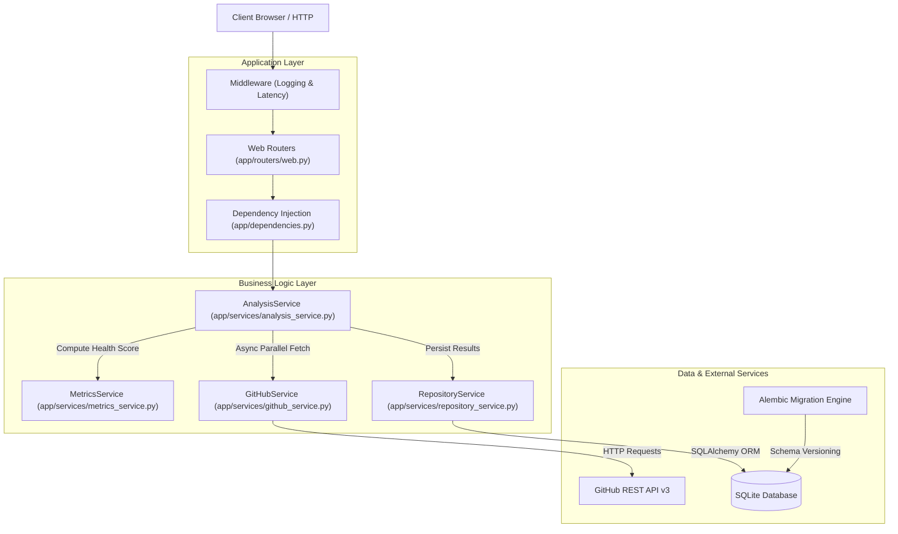
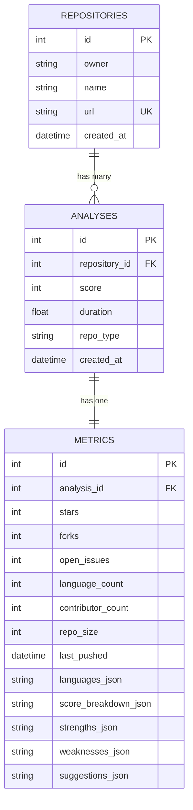

# ArchLens

Score the engineering health of any public GitHub repository from 0 to 100, with clear strengths, concerns and next steps.

[](https://github.com/vishnuatgit/ArchLens/actions/workflows/ci.yml)

[](LICENSE)

ArchLens is a FastAPI web app, REST API and CLI. It reads a repository's metadata through the GitHub REST API (it never clones code), scores it across seven dimensions, and stores every run in SQLite so you can revisit past reports.

---

## Live Demo

**[Open the live demo](https://TODO-render-url.onrender.com)** <!-- TODO: replace with the Render URL after the first deploy -->

Paste `owner/repo` (for example `psf/requests`) or a full GitHub URL. The REST API's interactive docs are at `/docs` on the same host.

The demo runs on Render's free tier, so:
- the first visit after a quiet spell is slow while the service wakes up;
- its database resets whenever the service restarts, after which three example reports (`psf/requests`, `pallets/flask` and this repository) are loaded again, labelled with the date they were captured;
- to share the GitHub API quota fairly, each visitor can start 5 new analyses per 10 minutes, and asking for the same repository and profile again within an hour reuses the existing report.

---

## Key Features

- **Multi-Dimensional Codebase Scoring**: Calculates an overall engineering health score (0–100) across 7 dimensions:
  - **Documentation**: README architecture overview, LICENSE permissions, CONTRIBUTING guidelines, and dedicated `docs/` directories.
  - **Activity & Velocity**: Commit frequency over 30 days and days since last release/push.
  - **Organization**: Dedicated source folders (`src/`, `app/`), test suites (`tests/`), and environment configuration manifests (`pyproject.toml`, `dockerfile`, `.env`).
  - **Community Engagement**: GitHub stars, forks, and unique active contributor base.
  - **Maintainability & CI/CD**: GitHub Actions workflows (`.github/workflows/`), open issue count, and repository size.
  - **Security**: `.gitignore`, a dependency lockfile, an `.env` template, and a `SECURITY.md` policy.
  - **Code Quality & Tooling**: linter/formatter config, type-checker config, and pre-commit hooks.

- **Personalized Repository Profiles**:
  - **Open Source Library**: Standard strict scoring across all 7 dimensions.
  - **Personal Project**: Curved scoring that automatically forgives missing CI/CD workflows, low star/fork counts, and `CONTRIBUTING.md` guides.
  - **Enterprise App**: Strictly evaluates test coverage and CI/CD automation while bypassing public community metrics.

- **Modern Dark Glassmorphic Dashboard**:
  - Built with raw CSS, Plus Jakarta Sans typography, ambient radial glow spheres, and backdrop blur glassmorphism.
  - SVG circular score gauge with health tier badges: *Strong Codebase* (70+), *Moderate Health* (40-69) and *Needs Optimization* (below 40). The same tiers drive the executive summary, the history badges and the CLI.
  - 6-tile frosted metadata strip (Stars, Forks, Open Issues, Contributors, Disk Size, Languages).
  - Multi-segment language distribution bars and categorised findings (Key Strengths, Areas of Concern, Actionable Recommendations).

- **Live Asynchronous GitHub Integration**: Async HTTP client (`httpx`) using `asyncio.gather()` to concurrently fetch live repository data, contents, workflows, languages, and commit history.
- **SQLite + Alembic Migration Engine**: Persistent storage for all historical analyses with versioned database migrations and dependency injection.
- **Tested**: unit and integration tests with Pytest and FastAPI's TestClient; GitHub API calls are mocked, so tests need no network.
- **Containerized**: multi-stage Docker build on `python:3.11-slim`, running as a non-root user with a health check.
- **CLI**: `archlens analyze <url> --profile personal` prints the same report in the terminal.

---

## Architecture Diagram



---

## Data Schemas & Entity Relationship Diagram



---

## Project Structure

```text
ArchLens/
├── main.py                 # FastAPI application entry point
├── pyproject.toml          # PEP 621 project configuration & tool settings
├── app/
│   ├── config.py               # Environment configuration settings
│   ├── dependencies.py         # FastAPI dependency injection providers
│   ├── exceptions.py           # Custom application exception hierarchy
│   ├── models/                 # SQLAlchemy database models (Repository, Analysis, Metric)
│   ├── repositories/           # DB session management & DAO queries
│   ├── routers/                # FastAPI web routes (/, /analyze, /analysis/{id}, /history, /health)
│   ├── schemas/                # Pydantic validation schemas
│   ├── services/               # GitHub API client, scoring engine, analysis orchestrator, rate limiter & example seeding
│   ├── seed/examples.json      # Example reports loaded into an empty database on startup
│   ├── templating.py           # Shared Jinja2 environment and display filters
│   ├── templates/              # Jinja2 HTML templates (base, home, results, history, 404)
│   └── static/                 # Glassmorphic CSS design system, favicon & assets
├── alembic/                    # Database migration scripts
├── scripts/
│   ├── build_examples.py       # Regenerates app/seed/examples.json from live analyses
│   └── seed.py                 # Script to seed live repository analysis data
├── tests/                      # Pytest unit & integration test suites
│   ├── unit/                   # Unit tests for services and parsers
│   └── integration/            # Integration tests for web routes and DB
├── Dockerfile                  # Multi-stage production container build
├── alembic.ini                 # Alembic migration configuration
├── requirements.txt            # Runtime dependencies (installed in the Docker image)
├── requirements-dev.txt        # Test and lint tools (pytest, ruff, black)
└── README.md                   # Project documentation
```

---

## Quick Start Guide

### Prerequisites
- **Python 3.11+**
- **Git**

### 1. Clone the Repository
```bash
git clone https://github.com/vishnuatgit/ArchLens.git
cd ArchLens
```

### 2. Create & Activate Virtual Environment
```bash
# On Linux/macOS
python3 -m venv .venv
source .venv/bin/activate

# On Windows (PowerShell)
python -m venv .venv
.venv\Scripts\activate
```

### 3. Install Dependencies
```bash
pip install -r requirements.txt       # to run the app
pip install -r requirements-dev.txt   # to also run the tests and linters
```

### 4. Run Database Migrations
Initialize the SQLite database schema using Alembic:
```bash
alembic upgrade head
```

### 5. (Optional) Configure GitHub Personal Access Token
Setting a GitHub Token increases your GitHub API rate limit from 60 to 5,000 requests per hour:
```bash
# On Linux/macOS
export GITHUB_TOKEN="your_personal_access_token"

# On Windows (PowerShell)
$env:GITHUB_TOKEN="your_personal_access_token"
```

### 6. Launch the FastAPI Development Server
```bash
uvicorn main:app --reload
```
Open your browser and navigate to **[http://127.0.0.1:8000](http://127.0.0.1:8000)**. On first start the empty database is filled with the example reports from `app/seed/examples.json` (set `SEED_EXAMPLES=false` to skip this).

---

## Seeding Live Data

To pre-populate the database with live analysis runs from popular public repositories (e.g. `octocat/Hello-World`, `fastapi/fastapi`, `pallets/flask`):

```bash
python scripts/seed.py
```

The example reports bundled with the app are regenerated with `python scripts/build_examples.py`, which analyzes the repositories listed in that script (about six GitHub API calls each) and rewrites `app/seed/examples.json`.

---

## API Reference

### Web Dashboard Routes

| Method | Endpoint | Description |
| :--- | :--- | :--- |
| `GET` | `/` | Home page with URL input form, profile selector, and recent scans |
| `POST` | `/analyze` | Form submission endpoint to trigger full repository analysis |
| `GET` | `/analysis/{id}` | Detailed engineering report dashboard for a specific scan ID |
| `GET` | `/history` | Paginated analysis history page |
| `GET` | `/health` | System health check endpoint returning API status |

### REST API v1 JSON Endpoints

| Method | Endpoint | Description |
| :--- | :--- | :--- |
| `POST` | `/api/v1/analyze` | Analyzes a repository from a JSON body (`{"url": "owner/repo", "repo_type": "library"}`). Returns `201` with a new report, or `200` when a report of the same repository and profile from the last hour is reused |
| `GET` | `/api/v1/analyses/{id}` | Fetches full structured JSON analysis report, health grade, and breakdown |
| `GET` | `/api/v1/analyses` | Paginated query list with filtering (`?offset=0&limit=20&min_score=80&repo_type=library`) |
| `GET` | `/api/v1/health` | REST API operational status health check |

> **Interactive API Documentation**: Access Swagger UI at `http://127.0.0.1:8000/docs` and ReDoc at `http://127.0.0.1:8000/redoc`.

Errors use one JSON shape, `{"error": "...", "error_code": "...", "status_code": 404}`:

| Status | `error_code` | When |
| :--- | :--- | :--- |
| `400` | `INVALID_URL` | The input is not `owner/repo` or a GitHub repository URL |
| `404` | `REPO_NOT_FOUND` | The repository does not exist or is private |
| `422` | `EMPTY_REPOSITORY` | The repository has no commits yet (an unknown `repo_type` is also a `422` request validation error) |
| `429` | `TOO_MANY_ANALYSES` | The client started too many analyses; see the `Retry-After` header |
| `502` | `GITHUB_UNAVAILABLE` | GitHub returned an unexpected error or could not be reached |
| `503` | `RATE_LIMIT_EXCEEDED` | The server's GitHub API quota is used up |

---

## Running Tests

ArchLens maintains a robust test suite covering services, web routes, and database operations.

Run all tests with Pytest, and the same lint checks as CI:
```bash
pip install -r requirements-dev.txt
pytest --cov=app tests/
ruff check app tests
black --check app tests
```

---

## Docker Deployment

To build and run the multi-stage production Docker container:

```bash
# 1. Build Docker Image
docker build -t archlens:latest .

# 2. Run Container
docker run -d -p 8000:8000 --name archlens-app archlens:latest
```

Access the containerized app at `http://localhost:8000`. The container applies Alembic migrations on start-up, and honours a `PORT` environment variable. Pass `-e GITHUB_TOKEN=...` to raise the GitHub rate limit.

---

## Configuration

| Variable | Default | Purpose |
| :--- | :--- | :--- |
| `DATABASE_URL` | `sqlite:///./ArchLens.db` | SQLAlchemy database URL |
| `GITHUB_TOKEN` | unset | Optional GitHub token; raises the API limit from 60 to 5,000 requests per hour |
| `LOG_LEVEL` | `INFO` | Python logging level |
| `ANALYSIS_CACHE_MINUTES` | `60` | Reuse a report of the same repository and profile created within this many minutes (`0` disables) |
| `ANALYSIS_RATE_LIMIT` | `5` | New analyses each client (by IP) may start per window (`0` disables) |
| `ANALYSIS_RATE_WINDOW_SECONDS` | `600` | Length of that rate-limit window |
| `SEED_EXAMPLES` | `true` | Load the example reports into an empty database on startup |

Copy `.env.example` to `.env` to set these locally.

---

## Deploy on Render

`render.yaml` is a Render Blueprint for a free Docker web service in the Singapore region with a `/health` check. The container applies Alembic migrations, then starts uvicorn on Render's `PORT`.

1. Create a GitHub token for the API quota: GitHub > Settings > Developer settings > Fine-grained tokens, with **Public repositories (read-only)** access and no extra permissions. ArchLens only reads public data, so the token needs nothing else.
2. In Render, choose **New > Blueprint** and select this repository. Render reads `render.yaml`.
3. When prompted, paste the token as the value of `GITHUB_TOKEN`. It is stored in Render, never in the repository.
4. After the first deploy, put the service URL in the **Live Demo** link above.

| Variable | Set by | Notes |
| :--- | :--- | :--- |
| `GITHUB_TOKEN` | You, in the Render dashboard (`sync: false`) | Raises the GitHub limit from 60 to 5,000 requests per hour |
| `LOG_LEVEL` | `render.yaml` | `INFO` |
| `PORT` | Render | Read by the container's start command |

The other settings in [Configuration](#configuration) keep their defaults unless you add them in the dashboard.

Free-tier caveats:
- The service sleeps after 15 minutes without traffic, so the first request after a pause is slow.
- SQLite lives on the container's ephemeral disk, so analysis history resets on every redeploy or restart; the example reports are then loaded again. Use a managed database through `DATABASE_URL` if you need history to persist.
- The per-visitor limit is kept in memory, so it resets on restart, and it trusts the first `X-Forwarded-For` address, which a determined client can forge. The GitHub token's quota and the one-hour reuse window are the backstop.

---

## Limitations

- Scores are heuristics based on repository metadata and the root directory listing; ArchLens does not read or execute source code.
- Unauthenticated use is limited to 60 GitHub API requests per hour (each analysis makes about six).
- Contributor and recent-commit counts come from the first page of results, so they are shown as "100+" at the cap.

---

## License

MIT. See [LICENSE](LICENSE).
