# ArchLens process flows

Every journey a visitor can take through ArchLens, and every flow the backend runs, with the files and functions involved and what happens when something goes wrong. File paths are relative to the repository root.

**User flows**

1. [Analyze a repository (live progress)](#1-analyze-a-repository-live-progress)
2. [Analyze without JavaScript](#2-analyze-without-javascript)
3. [Read a report](#3-read-a-report)
4. [Share and export a report](#4-share-and-export-a-report)
5. [Compare two repositories](#5-compare-two-repositories)
6. [Browse the history](#6-browse-the-history)
7. [Learn how scoring works](#7-learn-how-scoring-works)
8. [Use the REST API or the CLI](#8-use-the-rest-api-or-the-cli)

**System flows**

9. [The analysis pipeline](#9-the-analysis-pipeline)
10. [Streaming progress to the browser](#10-streaming-progress-to-the-browser)
11. [The GitHub client](#11-the-github-client)
12. [Scoring, evidence and the fix plan](#12-scoring-evidence-and-the-fix-plan)
13. [Reuse window and per-visitor limit](#13-reuse-window-and-per-visitor-limit)
14. [README badge](#14-readme-badge)
15. [Startup, storage and example reports](#15-startup-storage-and-example-reports)
16. [Errors: one vocabulary, three surfaces](#16-errors-one-vocabulary-three-surfaces)
17. [Renamed and transferred repositories](#17-renamed-and-transferred-repositories)

---

## 1. Analyze a repository (live progress)

The main journey. A visitor pastes `owner/repo` or a GitHub URL on the home page and watches the "How it works" steps light up as the analysis actually runs, then lands on the report.

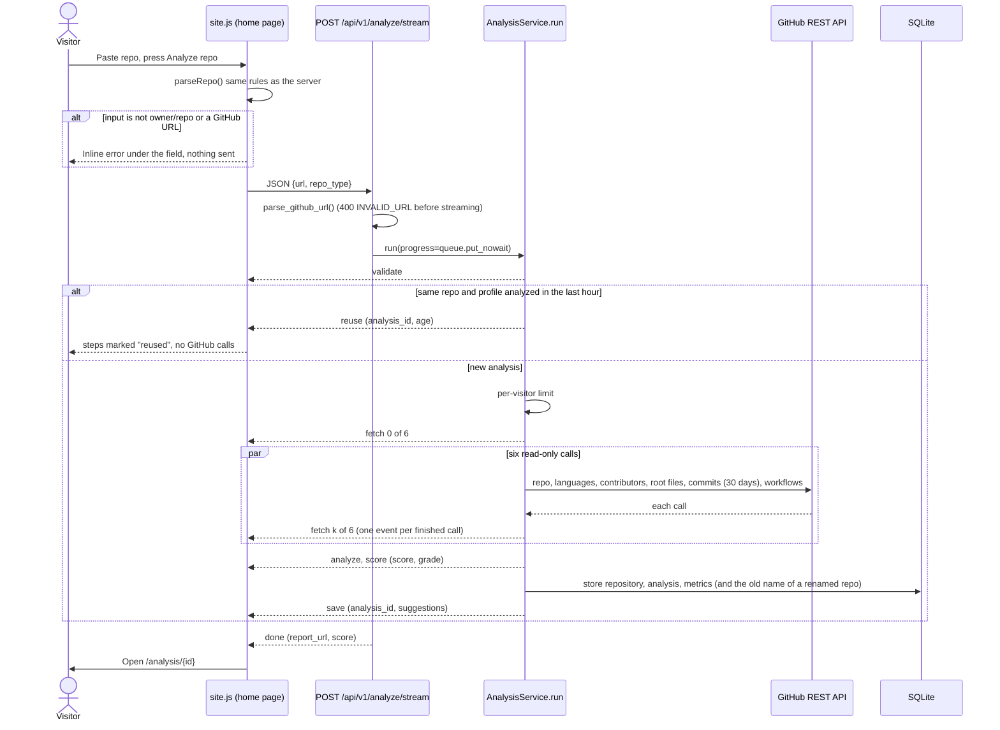

**Entry points:** the form `#analyze-form` in `app/templates/home.html`, with one-click example chips (`data-fill`) and the profile select. A report's **Analyze again** / **Run a fresh analysis** and the 404 page's **Analyze owner/repo** link to `/?url=owner/repo&repo_type=…&autostart=1`: `home()` in `app/routers/web.py` fills the form and adds `data-autostart`, and `site.js` submits it on load, so re-runs go through the same live steps. It auto-starts only when the link came from an ArchLens page (same-origin `document.referrer`), and removes `autostart` from the address so a reload does not run it again.

**Steps**

1. `site.js` validates the input with `parseRepo()`, which mirrors `_URL_PATTERN` and `_SLUG_PATTERN` in `app/services/github_service.py`. Invalid input shows an inline message (`#repo-error`) and focuses the field; nothing is sent.
2. The button switches to "Analyzing…" with a spinner (`setBusy`), the pipeline is reset and marked running, and on phones it is scrolled into view.
3. `fetch()` posts JSON to `POST /api/v1/analyze/stream` (`analyze_repository_stream` in `app/routers/api.py`). The response is newline-delimited JSON, read with a `ReadableStream` reader in `readStream()`.
4. Each event goes through a small queue (`enqueue`/`drain`). Events are real; the queue only spaces them by 70 to 170 ms so a fast analysis is still visible (no pause under `prefers-reduced-motion`).
5. `handle()` maps events to the four steps: `fetch` (with six ticks, one per GitHub call: `metadata`, `languages`, `contributors`, `root_files`, `commits`, `workflows`), `analyze` ("Check 7 dimensions"), `score` ("Score and grade") and `save` ("Suggest next steps"). The active step has a spinning ring; finished steps get a check. The status line (`#pipeline-status`, `aria-live="polite"`) narrates each step.
6. If no GitHub call has finished after 4 seconds (`watchForSlowGitHub()`), the fetch step says "Waiting for GitHub…" and the status line "GitHub is slow to answer. Still trying…" (the client retries 5xx answers and timeouts, flow 11).
7. On `done`, the page navigates to `report_url` (`/analysis/{id}`).

**Reuse path:** when the same repository and profile were analyzed in the last `ANALYSIS_CACHE_MINUTES` (60), the stream sends `validate`, `reuse` and `done`. The four steps are marked **reused** (a database icon on a dashed card, not a green check, because nothing ran), the fetch step says "Skipped: analyzed N minutes ago", the score step shows the stored score from the `done` event, and the stored report opens. No GitHub calls are made.

**Error paths.** Each ends with the button re-enabled. Errors after the analysis started mark the running step as failed, clear its call ticks, say why in that step ("Repository not found", "Repository has no commits", "GitHub quota used up", "GitHub did not answer", otherwise "Stopped"), and the status line says "Stopped. Nothing was saved." The per-visitor limit is refused before any step runs, so it says "Not started. Nothing was saved."

| What happens | Where it is detected | What the visitor sees |
| :--- | :--- | :--- |
| Input is not a repository | `parseRepo()` in the browser; `parse_github_url()` on the server (400) | Inline field error |
| Repository does not exist or is private | GitHub 404 on the metadata call, `RepositoryNotFoundError`; the other calls are cancelled | Inline field error with the message, field focused |
| Repository is empty | GitHub 409 on commits, `EmptyRepositoryError` (422) | Inline field error with the message |
| Too many new analyses from this visitor | `SlidingWindowRateLimiter.hit()`, `TooManyAnalysesError` (429) | Error box; "Try again in m:ss" counts down to the `retry_after` the server sent; pipeline says "Not started" |
| Server's GitHub quota used up | GitHub 403/429, `RateLimitExceededError` (503); the visitor's analysis is refunded | Error box with the minutes until GitHub resets |
| GitHub error or unreachable | `UpstreamServiceError` (502) after retries; the visitor's analysis is refunded | Error box; "Try again" works straight away |
| Unexpected server failure | Caught in `stream_analysis()`, sent as `INTERNAL_ERROR` without internals | Error box |
| Network down or stream cut | `fetch()` rejects, or the stream ends without `done`/`error` | "Could not reach ArchLens…" or "The connection closed before the analysis finished…" |
| Back button after leaving | `pageshow` with `event.persisted` | Form and pipeline reset, button usable |

The error box (`#stream-error`) has "Try again" (resubmits the form) and "Browse stored reports".

---

## 2. Analyze without JavaScript

The same form works as a plain HTML form, and `site.js` falls back to it when the browser cannot stream (`fetch`, `TextDecoder` or `ReadableStream` missing).

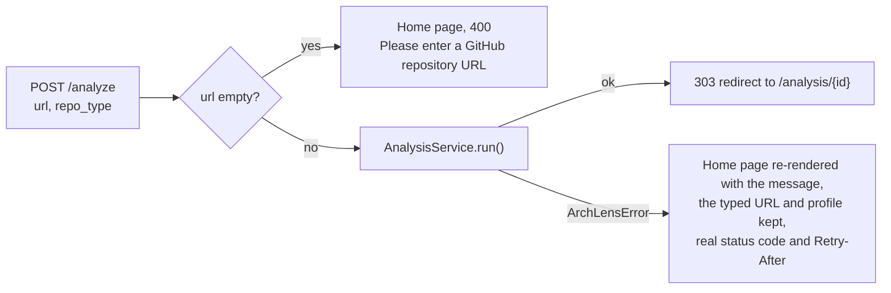

**Files and functions:** `analyze()` and `render_home()` in `app/routers/web.py`. `GET /analyze` (a reload of the POST target) redirects to `/` (`analyze_form_redirect`). The error is shown in `#form-error` with `role="alert"`. The input gets `aria-invalid` only when the input itself is the problem (`INPUT_ERROR_CODES`: `INVALID_URL`, `REPO_NOT_FOUND`, `EMPTY_REPOSITORY`); a 429, 502 or 503 leaves the field as it was. Without JavaScript, an "Analyze again" link opens the home page with the form filled in, one click away.

---

## 3. Read a report

`GET /analysis/{id}` (`results()` in `app/routers/web.py`, template `app/templates/results.html`).

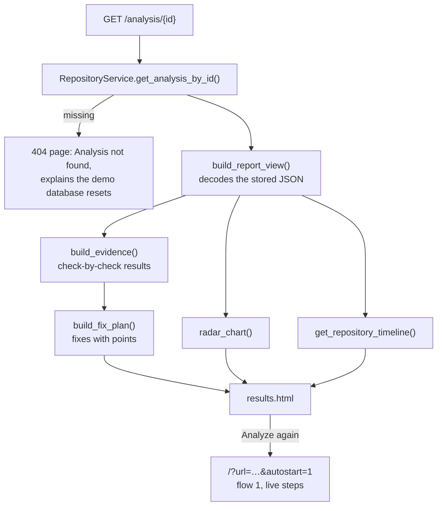

**What the page shows, top to bottom**

1. Header: repository, profile, example tag, report number, analysis time and duration; actions: Copy link, Export menu (copy Markdown, download `.md`, view JSON), Compare, GitHub.
2. Banner: "Example report" with **Run a fresh analysis** for bundled examples, or "This report is from …" with **Analyze again** for live reports older than the reuse window (`refreshable` in `results()`). Both link to the home page with `autostart` (`rerun_url`), so the re-run shows the live pipeline (flow 1).
3. Overview: the score gauge, grade and tier; the executive summary with four figures (dimensions at full marks, checks passed, concerns, points within reach and the projected grade).
4. Repository facts: stars, forks, open issues, contributors (shown as `100+` at the API page cap), last push ("Oct 26" in the scan's year, "Nov 2024" otherwise, with days before the scan), CI workflows (from the CI check's evidence, `workflow_count()`), size and languages.
5. What to fix first: the fix plan (flow 12), ordered with exact file-level fixes first, each with `+N` or `up to +N`, a bar projecting the score after the exact fixes, and **Copy checklist** (a Markdown task list). If a report's evidence cannot be verified, the scorer's stored suggestions are listed instead, without points.
6. Beside it: the dimension profile, a radar chart of each dimension's share of its points with the strongest and weakest dimensions named, and the languages, a bar in GitHub's language colours with a legend.
7. Dimension scores: seven expandable rows (`
`, plus **Expand all**). Each lists its checks with a status icon (passed, partial, missing, given, not scored), the scorer's own sentence or the file names the check looks for, and the points earned, aligned under the dimension's points. A link opens that dimension on `/scoring`. Linking to `#dim-security` opens that row.
8. All findings: key strengths and areas of concern side by side, as in the first design (on phones the concerns come first).
9. README badge: preview and Markdown, HTML and image-URL snippets in tabs, each with Copy. The badge URL carries the report's profile (`?profile=library`).
10. Score history: every stored report of the repository (date, profile and Example tags, score bar, grade, score), shown only when there is more than one. Rows without a stored grade show the grade their score maps to (`grade_for`), never a made-up one.

**Empty and edge states:** "Nothing to fix" when every applicable check passed; "No summary was stored"; "GitHub reported no languages"; a note on dimensions stored without check-level detail.

---

## 4. Share and export a report

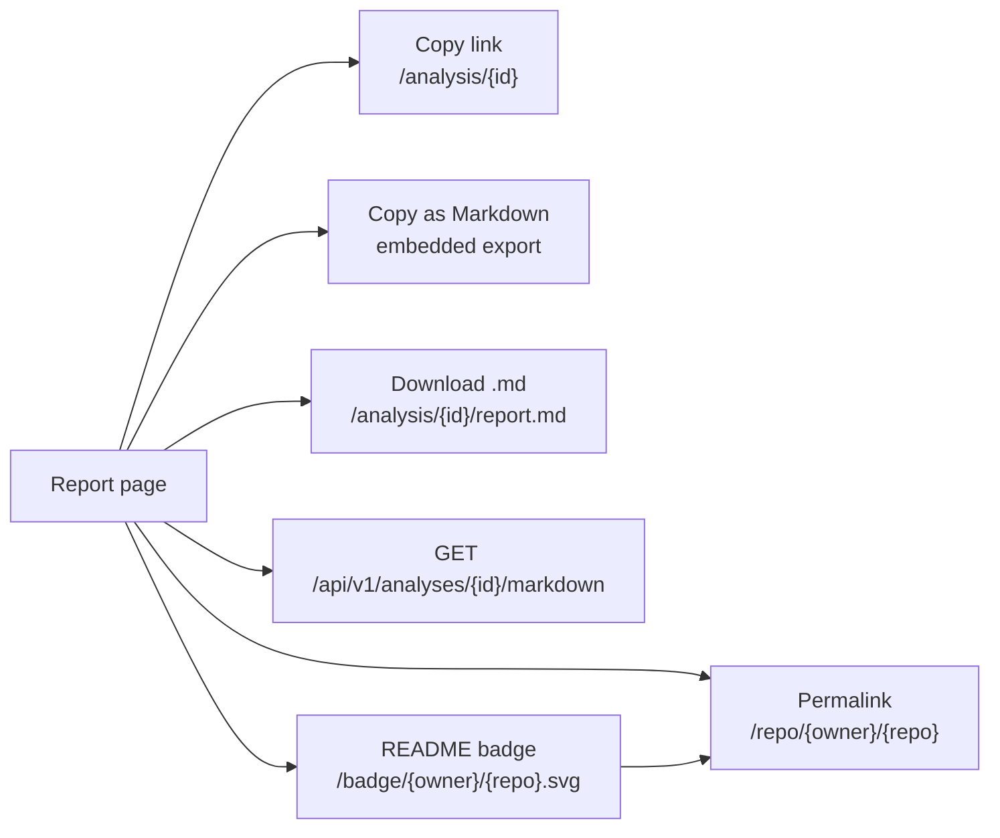

* **Copy link / Copy as Markdown / Copy checklist / badge snippets:** buttons with `data-copy-text` or `data-copy-from` in `site.js`. They use the Clipboard API and fall back to a hidden textarea on plain-HTTP hosts. Success and failure appear as a toast in `#toasts` (`role="status"`, read by screen readers).
* **Markdown export:** `report_to_markdown()` in `app/services/report_export.py` writes the score, grade, tier, profile, dimension table, the fix plan with points (or the stored suggestions), concerns, strengths and repository facts. The download sets `Content-Disposition` with `markdown_filename()`, for example `archlens-psf-requests-2026-10-31.md`.
* **Permalink:** `latest_report()` in `app/routers/web.py` redirects `/repo/{owner}/{repo}` (case-insensitive, following recorded renames, flow 17) to the newest stored report with a 303. Report IDs change when the demo database resets; this address does not. With no report, it returns a 404 page whose **Analyze owner/repo** button starts the live analysis on the home page.

---

## 5. Compare two repositories

`GET /compare?a=…&b=…&profile=…` (`compare()` and `_resolve_compare_side()` in `app/routers/web.py`, template `app/templates/compare.html`).

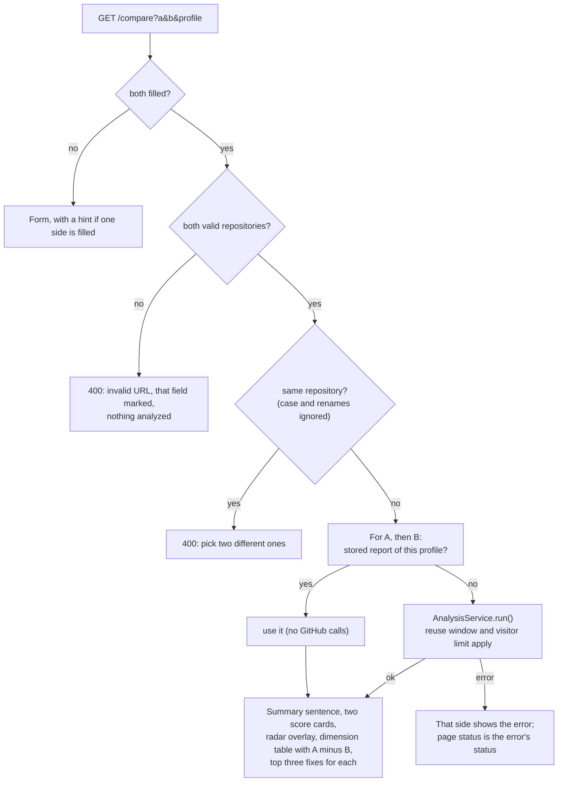

**Details:** suggestions come from stored repositories (`<datalist>` from `list_repository_names()`), and example pairs are one-click chips. Both inputs are validated in the browser first (`data-validate-repo`); the swap button exchanges A and B. While the GET request runs, the button shows "Comparing…" (its width is fixed, so the fields do not move) and a skeleton replaces the previous results (`data-busy-skeleton`). The status line says what the server will actually do: the form carries every stored repository and profile pair (`data-stored`, from `list_stored_reports()`), so `compareStatus()` in `site.js` shows "Loading the two stored reports…" or "Analyzing owner/repo on GitHub. This takes a few seconds…". An error about one side marks that field (`failed_side`: `aria-invalid` plus `aria-describedby` pointing at the message); a side GitHub does not know shows its error in its own card. Under the radar chart, the page names the dimensions each repository leads and how many are tied. `describe_comparison()` in `app/services/report_view.py` writes the summary, naming who each number belongs to ("pallets/flask scores 4 points higher (81 vs 77). The biggest difference is activity: 11 for pallets/flask vs 9 for psf/requests, out of 15.").

---

## 6. Browse the history

`GET /history?q=&profile=&sort=&offset=&limit=` (`history()` in `app/routers/web.py`; `get_history()` and `count_history()` in `app/services/repository_service.py`).

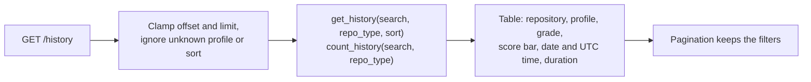

* Search matches anywhere in `owner/name`, case-insensitively. Sorts: newest, oldest, highest score, lowest score, repository name (`HISTORY_SORTS`).
* With JavaScript, typing filters the visible rows instantly (the count line follows: "4 of 12 on this page match. Press Enter to search every stored report.") and Enter searches every stored report; the profile and sort selects apply on change. `/` focuses the search box.
* The "Analyzed" column shows the date and UTC time, with the relative time ("4 hours ago") underneath when JavaScript is on.
* States: "No analyses yet" (empty database), "No reports match" with **Clear filters** (and **Analyze a repository** when searching), and a filtered count ("2 of 3 reports match").

---

## 7. Learn how scoring works

`GET /scoring?profile=…` (`scoring()` in `app/routers/web.py`; `build_scoring_guide()`, `grade_ranges()`, `tier_ranges()` and `profile_options()` in `app/services/scoring_guide.py`).

The page is generated from the constants in `app/services/metrics_service.py`: one proportional bar of how the 100 points split across the seven dimensions (the same at every width) with a legend linking to each dimension, a sticky sidebar with dimension totals, grades and tiers, and one table per dimension listing each check, the files it looks for, its points and partial-credit bands. The profile switcher marks checks as **given** (full points without checking) or **not scored**. Unknown profiles fall back to `library`. `tests/unit/test_scoring_guide.py` runs the real scorer against these numbers.

`GET /about` (`about()`) explains the problem, architecture, stack, design decisions and limitations, using the live settings for the reuse window and visitor limit.

---

## 8. Use the REST API or the CLI

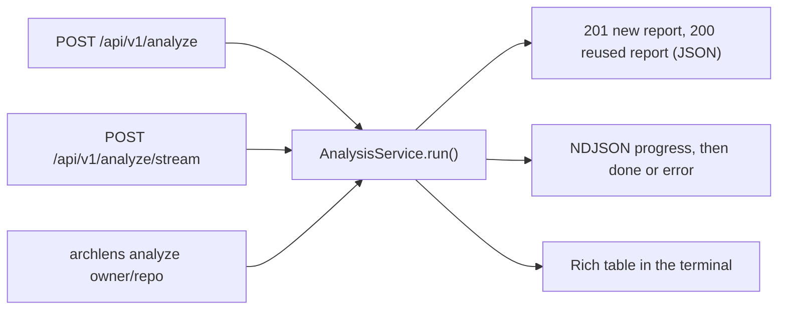

* `POST /api/v1/analyze` returns the full report as JSON: `201` for a new analysis, `200` when a report from the last hour is reused (`analyze_repository()` in `app/routers/api.py`).
* `POST /api/v1/analyze/stream` is flow 10.
* `GET /api/v1/analyses` (paginated, `repo_type` and `min_score` filters), `GET /api/v1/analyses/{id}`, `GET /api/v1/analyses/{id}/markdown` and `GET /api/v1/health`. Endpoints are tagged Analyses, Reports, Badges and System in `/docs`; HTML pages are left out of the schema.
* The CLI (`app/cli.py`, installed as `archlens` by `pip install -e .`) runs `AnalysisService` directly against the local database with no reuse window and no visitor limit, and prints the report with Rich: `archlens analyze psf/requests`, or `archlens analyze <url> --profile personal`. An `@app.callback()` keeps `analyze` a named subcommand (Typer would otherwise fold a single command into the app). Errors print a message and exit with code 1.

---

## 9. The analysis pipeline

`AnalysisService.run(db, url, repo_type, client_id, progress)` in `app/services/analysis_service.py`. Every entry point (web form, both API endpoints, compare page, CLI) calls it.

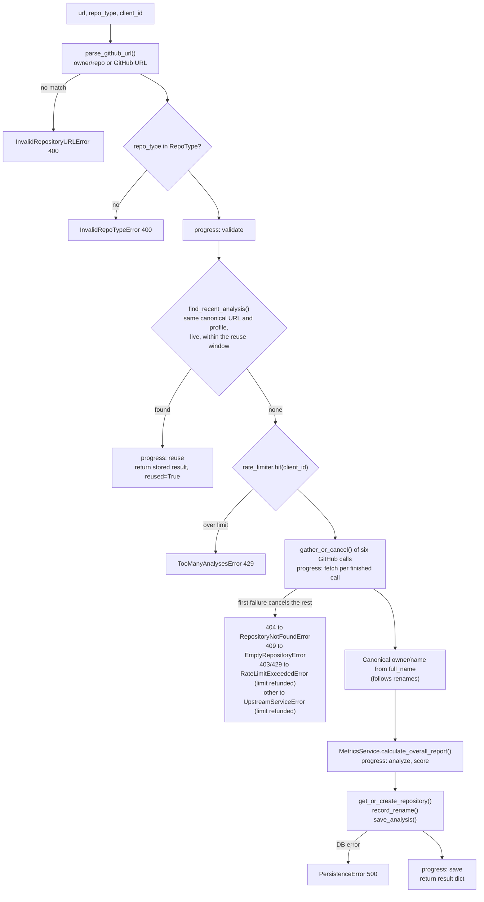

**Inputs:** a URL or `owner/repo`, a profile (`library`, `personal`, `enterprise`), a client id (the first `X-Forwarded-For` address or the socket address, from `get_client_ip()` in `app/dependencies.py`), and an optional progress callback.

**Outputs:** a dict with `analysis_id`, `score`, `breakdown`, findings and `reused`. Stored rows: `repositories` (one per canonical URL `https://github.com/{owner}/{repo}`), `analyses` (score, duration, profile, `is_example`, time) and `metrics` (raw counts, last push, grade, summary, and JSON columns for languages as percentages, the breakdown, strengths, weaknesses and suggestions).

**Concurrency:** `gather_or_cancel()` wraps each call in a task and awaits them with `asyncio.gather`; if one raises (a 404 on the metadata call, say), the calls still running are cancelled instead of spending more GitHub quota, and the error is mapped as shown. `tests/unit/test_analysis_service.py` checks that a slow call is cancelled.

**Progress events** (`report()` inside `run`): `validate`, `reuse`, `fetch` (once before the calls with `completed: 0`, then once per finished call with its name; the sixth is `status: done`), `analyze` (running, then done with the number of findings), `score` (score and grade) and `save` (analysis id and number of suggestions). Results are written only after scoring, so a failure or cancellation never leaves half a report.

---

## 10. Streaming progress to the browser

`analyze_repository_stream()` and `stream_analysis()` in `app/routers/api.py`.

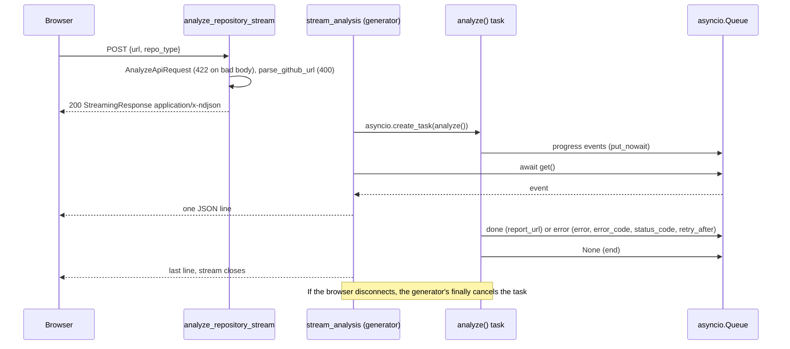

**Details:** the response sets `Cache-Control: no-store` and `X-Accel-Buffering: no` so proxies do not buffer it. Errors after the stream has started cannot change the HTTP status, so they travel as an `error` event carrying the same `error_code` and `status_code` the other endpoints use. Unexpected exceptions are logged with a stack trace and sent as `INTERNAL_ERROR` with a generic message. The database session comes from `get_db`, a request-scoped dependency that FastAPI closes after the response has finished streaming.

---

## 11. The GitHub client

`GitHubService` in `app/services/github_service.py`.

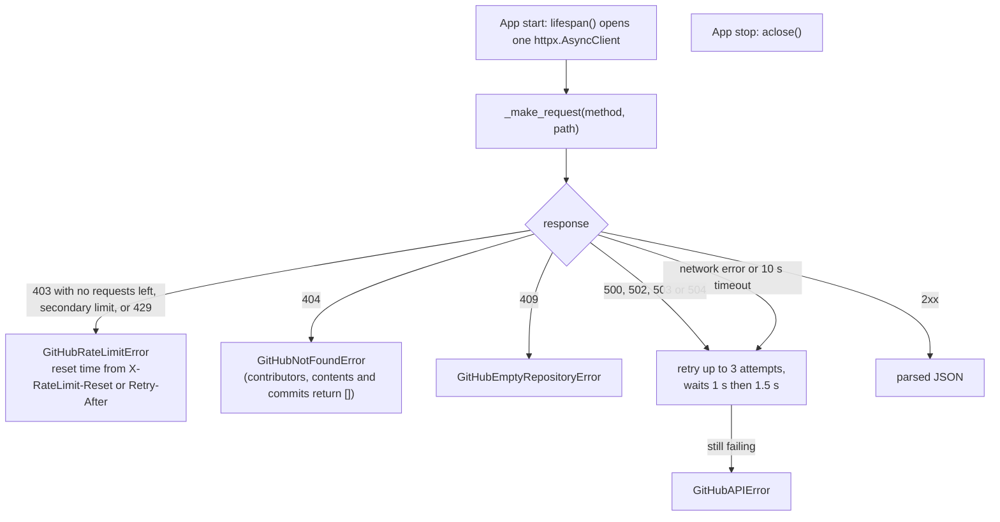

* One shared `httpx.AsyncClient` (opened in `lifespan()` in `main.py`, closed on shutdown) keeps connections pooled across the six concurrent calls. The CLI opens it on first use.
* Requests send `Accept: application/vnd.github.v3+json`, a `User-Agent`, and `Authorization` when `GITHUB_TOKEN` is set (60 requests an hour without a token, 5,000 with one).
* Redirects are followed, so renamed repositories work; the canonical name is then taken from `full_name`.
* User input only reaches API paths after `parse_github_url()` has restricted it to GitHub's owner and repository name characters.

---

## 12. Scoring, evidence and the fix plan

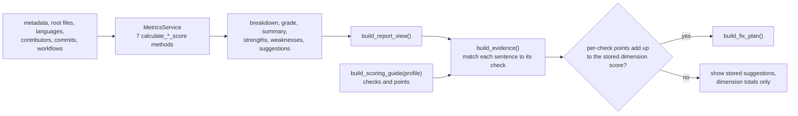

* **Scoring** (`app/services/metrics_service.py`): every point value, threshold and file name is a named constant. Dimensions: documentation 15, activity 15, organization 15, community 15, maintainability 15, security 12, code quality 13. Grades: A+ from 95, A 85, B+ 75, B 65, C 50, D 35, F below. Tiers: Strong Codebase 70+, Moderate Health 40 to 69, Needs Optimization below 40. The personal profile skips the license, contributing and test-folder checks and awards community, CI, security-policy, type-checker and pre-commit points without checking; the enterprise profile awards community points.
* **Evidence** (`app/services/evidence.py`): each sentence the scorer writes belongs to one check (`SIGNALS`), so `build_evidence()` lines the stored sentences up with the checks from `build_scoring_guide()`. Checks that write nothing (the personal profile's folder checks, a missing environment template) are resolved as the only combination of points that makes the dimension add up (`_resolve_silent()`). A dimension is `verified` only when its checks add up to the stored score exactly; a report with no matching sentences at all (an older format) is never verified. `tests/unit/test_evidence.py` runs the real scorer over about 900 generated repositories and checks every dimension and every file check.
* **Fix plan:** `build_fix_plan()` lists every check that lost points and has an action, using the scorer's own suggestion when it wrote one (`ACTIONS`). File-level checks are exact (`+4`); banded checks such as commits or open issues are "up to". Exact fixes come first, largest gain first, and their total gives the projected score and grade. It returns `None` unless every dimension is verified, so a plan never drops a suggestion.

---

## 13. Reuse window and per-visitor limit

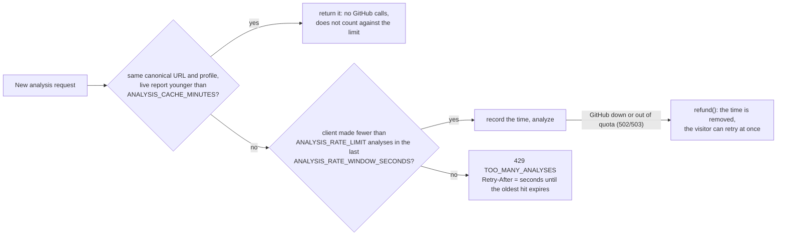

* `find_recent_analysis()` in `app/services/repository_service.py` ignores example reports, so "Run a fresh analysis" on an example really reaches GitHub. It looks up the URL through `resolve_url()` first, so an old name of a renamed repository reuses the report stored under the new name (flow 17).
* `SlidingWindowRateLimiter` (`app/services/rate_limiter.py`) keeps a deque of timestamps per client in memory and forgets idle clients past 10,000 entries. Defaults: 60-minute reuse window, 5 analyses per 10 minutes; `0` disables either.
* Every new analysis counts, including one for a repository that does not exist (so the limit still deters scanning). One that fails because of GitHub (`GitHubRateLimitError` or `GitHubAPIError`, surfaced as 503 or 502) is refunded with `SlidingWindowRateLimiter.refund()`, which removes the client's newest timestamp.
* The compare page and `/repo/...` links use stored reports first; the badge never analyzes.

---

## 14. README badge

`GET /badge/{owner}/{repo}.svg?profile=` (`repo_badge()` in `app/routers/badge.py`, rendering in `app/services/badge_service.py`).

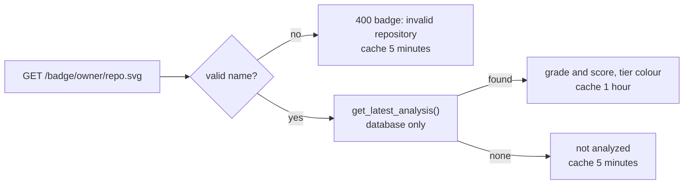

The badge reads the database only, so a popular README cannot drain the GitHub quota. The snippet on the report links the badge to `/repo/{owner}/{repo}`, which always opens the newest report. Text is escaped and sized with `textLength` so it renders the same without the font.

---

## 15. Startup, storage and example reports

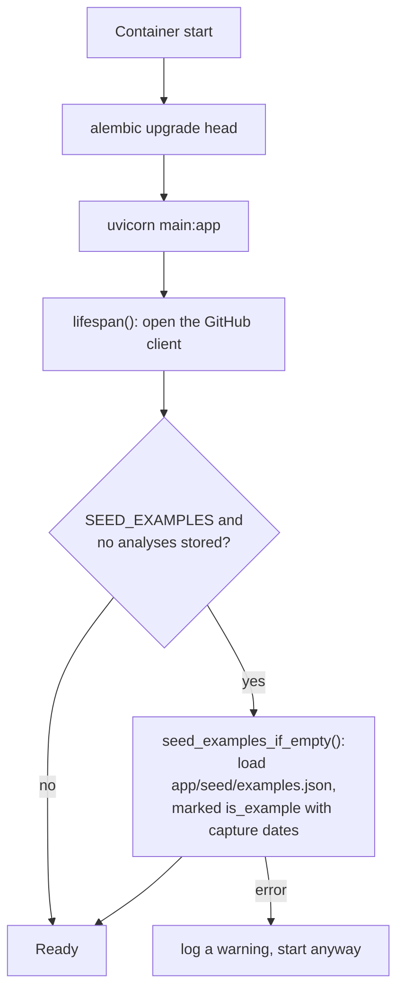

* Schema changes are Alembic migrations in `alembic/versions/` (five: the initial schema, the profile column, scores and summary, the example flag, and repository aliases). The demo host's disk is ephemeral, so the bundled examples (real analyses captured by `scripts/build_examples.py`) refill an empty database; pages label them "Example" with their capture date.
* `LoggingMiddleware` logs every request with its duration and adds `X-Process-Time`.

---

## 16. Errors: one vocabulary, three surfaces

Each failure is a subclass of `ArchLensError` in `app/exceptions.py` with its own status and code.

| Exception | Status | `error_code` | Typical cause |
| :--- | :--- | :--- | :--- |
| `InvalidRepositoryURLError` | 400 | `INVALID_URL` | Input is not `owner/repo` or a GitHub URL |
| `InvalidRepoTypeError` | 400 | `INVALID_REPO_TYPE` | Unknown profile on the web form (the API answers 422) |
| `RepositoryNotFoundError` | 404 | `REPO_NOT_FOUND` | Repository missing or private |
| `AnalysisNotFoundError` | 404 | `ANALYSIS_NOT_FOUND` | Unknown report id in the API |
| `EmptyRepositoryError` | 422 | `EMPTY_REPOSITORY` | No commits yet |
| `TooManyAnalysesError` | 429 | `TOO_MANY_ANALYSES` | Per-visitor limit, with `Retry-After` |
| `PersistenceError` | 500 | `PERSISTENCE_ERROR` | Database write failed |
| `UpstreamServiceError` | 502 | `GITHUB_UNAVAILABLE` | GitHub error or unreachable after retries |
| `RateLimitExceededError` | 503 | `RATE_LIMIT_EXCEEDED` | Server's GitHub quota used up, with `Retry-After` when known |

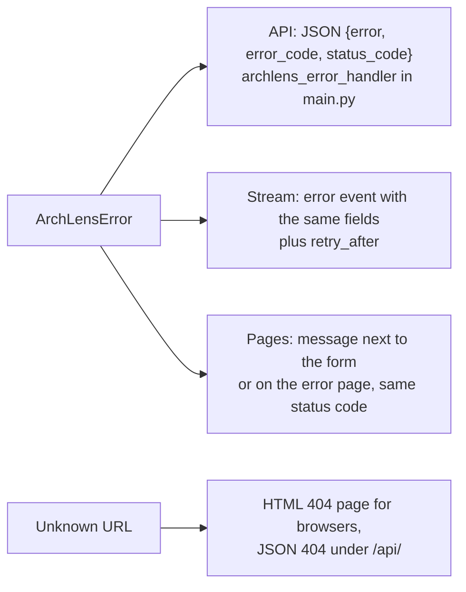

The HTML error page (`app/templates/404.html`) always offers a way forward: **Analyze a repository** and **Browse reports**, or **Analyze owner/repo** when a `/repo/...` link has no report yet.

---

## 17. Renamed and transferred repositories

GitHub redirects an old repository address after a rename or transfer (for example `encode/starlette` now answers as `Kludex/starlette`). ArchLens stores the report under the canonical name and remembers the name that was asked for.

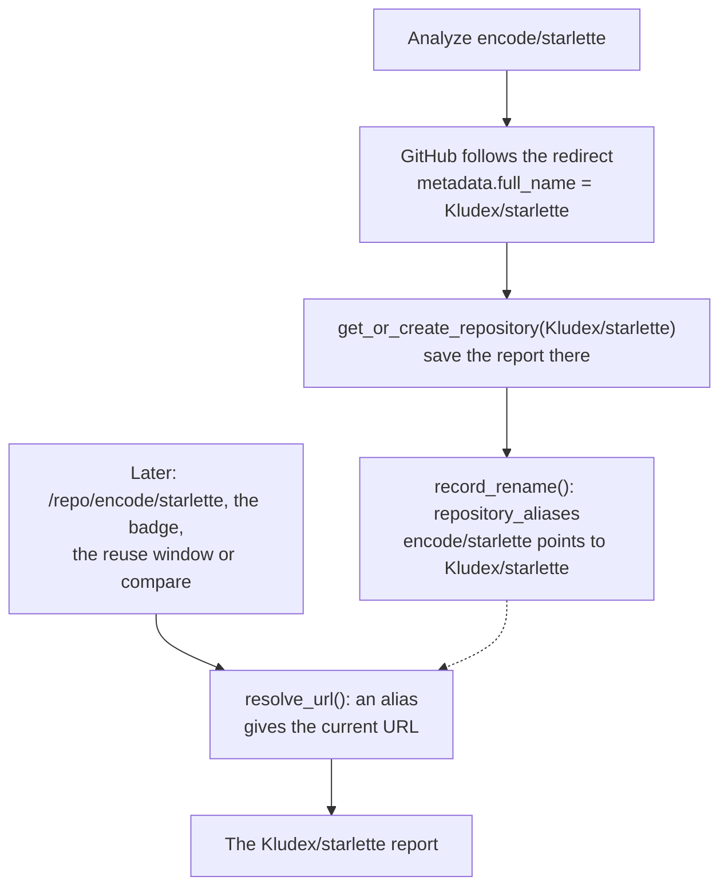

* **Files and functions:** `RepositoryAlias` in `app/models/db_models.py` (table `repository_aliases`, migration `7d2f9c4e8a1b`); `record_rename()` and `resolve_url()` in `app/services/repository_service.py`; called from `AnalysisService.run()` after the repository is stored, and from `find_recent_analysis()`, `get_latest_analysis()` (permalink, badge, compare) and `_same_repository()` in `app/routers/web.py`.
* **Stale names:** a repository's own URL is never kept as an alias. If someone later creates a new repository at the old address and it is analyzed, `record_rename()` deletes that alias, so the old name stops redirecting.
* **Limit:** renames are learned, not looked up: the old name finds the new reports only after it has been analyzed once under the old name (looking renames up would cost a GitHub call on every permalink or badge request).
* **Tests:** `tests/integration/test_user_flows.py` (`TestRenamedRepositories`) and `test_the_requested_name_of_a_renamed_repository_is_recorded` in `tests/unit/test_analysis_service.py`.

---

## 18. Dependencies and known vulnerabilities

Part of `AnalysisService.run()`, after the six GitHub calls and before scoring (`app/services/dependency_service.py`).

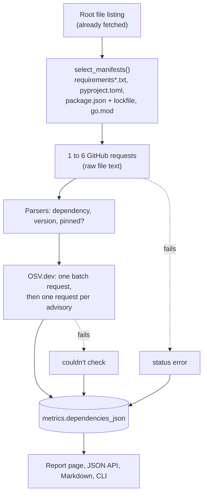

A failure at either step is recorded in the scan and never fails the analysis. The score is not affected. Reports stored before the feature existed have no scan and say "Not scanned".
