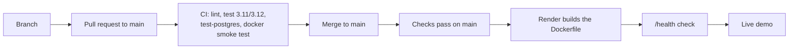

# Software development lifecycle: ArchLens

ArchLens scores a public GitHub repository's engineering health out of 100 and lists what to fix first. It is a FastAPI web app, REST API and CLI, written by one person (Chandana Vishnu Jayanth). Work was iterative. The first commits (2026-06-24 to 2026-07-27) went straight to `main`. From 2026-10-23 the history shows short-lived branches merged through pull requests. The first commit is dated 2026-06-24 and the latest 2026-11-09. The repository has 76 commits. Eleven are merge commits for pull requests #3 to #13, and pull request #1 was squash-merged (its title ends in "(#1)"). `git log` does not show what happened to #2.

## 1. Planning and requirements

- **Problem and users.** Checking a repository by hand takes about ten minutes of clicking. ArchLens runs the checklist in one request ([README](../README.md)). Users are people judging a public repository, and maintainers who want a fix list.
- **Functional scope.** Seven scored dimensions, grades A+ to F, evidence per check, a fix list with points, dependency and vulnerability listing, compare, history, Markdown export, README badge, REST API, CLI and a GitHub Action (README, Features).
- **Non-functional.** Runs on a free host, with request reuse (one hour) and a per-visitor limit of 5 analyses per 10 minutes. Scores stay comparable over time (the dependency scan does not change the score). Every published number is measured with its method stated ([roadmap](roadmap.md)).
- **Out of scope.** The README's Limitations section lists them: no source-file reading, no test runs, no coverage measurement, a single instance, and ephemeral demo storage. The [roadmap](roadmap.md) records ideas considered and not built: an organisation dashboard, AI suggestions, Redis, and per-pull-request scoring.
- **Prioritisation.** The roadmap records the decision to build three features and in what order (pull requests 8 to 10).

## 2. Design

- **Layers.** Routers (`web`, `api`, `badge`) call services (`analysis_service`, `github_service`, `metrics_service`, `dependency_service` and others). Services use SQLAlchemy models and Pydantic schemas. The CLI and the Action reuse the same service layer. See "Project structure" in the [README](../README.md).
- **Data model.** Four tables in [db_models.py](../app/models/db_models.py): `repositories`, `repository_aliases`, `analyses` and `metrics`. There are six Alembic migrations in [alembic/versions](../alembic/versions), starting with `ffb8c3aa7d85_initial_schema`. CI applies them up, down and up again.
- **Recorded decisions.** Scoring rules are named constants, and the `/scoring` page is generated from them. Dependency data is stored as JSON in one column. The read-only handlers are plain `def` functions after a load test showed `async def` handlers exhausting the connection pool ([walkthrough 3](walkthroughs/03-performance-and-postgres.md)). Each walkthrough has a "Design choices and trade-offs" table: [1](walkthroughs/01-dependency-vulnerabilities.md), [2](walkthroughs/02-github-action.md), [3](walkthroughs/03-performance-and-postgres.md).
- **Flows.** [process-flows.md](process-flows.md) documents 18 flows with diagrams, files and error paths.

## 3. Implementation

- **Stack.** Python 3.11 or newer. Runtime versions are pinned in [requirements.txt](../requirements.txt): fastapi 0.138.1, uvicorn 0.49.0, pydantic 2.13.4, sqlalchemy 2.0.51, alembic 1.18.5, httpx 0.28.1, jinja2 3.1.6, typer 0.27.0, rich 15.0.0. Dev tools are pinned in [requirements-dev.txt](../requirements-dev.txt): pytest 9.1.1, ruff 0.17.2, black 26.10.1. [pyproject.toml](../pyproject.toml) holds only lower bounds.
- **Layout.** `app/` (routers, services, models, schemas, templates, static), `alembic/`, `tests/`, `scripts/`, `docs/`. The front end has no build step.
- **Standards.** Ruff and Black with a line length of 100 ([pyproject.toml](../pyproject.toml)). [.pre-commit-config.yaml](../.pre-commit-config.yaml) runs them locally, and CI runs them again. [CONTRIBUTING.md](../CONTRIBUTING.md) describes the flow.
- **Branches.** Merged branches seen in merge messages: `add-mit-license`, `readme-license`, `readme-case-study`, `fix/functionality`, `auto-deploy`, `feat/dependency-vulnerabilities`, `feat/github-action`, `feat/perf-and-postgres`, `proofread`, `pin-dependencies`, `docs-sdlc-uat`. 52 non-merge commits sit directly on `main`'s first-parent line, most from before pull requests started, so many changes were committed to `main` directly.

## 4. Testing

`python -m pytest --collect-only -q` in the repo's `.venv` collected 332 tests. CI runs them ([ci.yml](../.github/workflows/ci.yml)).

| Level | What it covers | Where | Count |
| :--- | :--- | :--- | --: |
| Unit | Scorer, scoring guide, evidence, dependency parsers, GitHub client, rate limiter, CLI, badge, export, `action.yml`, migrations | [tests/unit](../tests/unit) (16 files) | 180 |
| Integration | Every page and API route, user flows, progress stream, with GitHub mocked | [tests/integration](../tests/integration) (7 files) | 152 |
| of which DB portability and end-to-end | Database portability (12), dependency end-to-end through the API (7) | `test_database_portability.py`, `test_dependencies_e2e.py` | 19, counted in the 150 |
| PostgreSQL run | Same suite on PostgreSQL 16, plus migrations up, down, up | `test-postgres` job in CI | CI only |
| Coverage | `pytest --cov=app`, printed per run; no minimum is set | `test` job (Python 3.11 and 3.12) | CI only |
| Lint | Ruff and Black checks | `lint` job | CI only |
| Container smoke test | Builds the image, calls `/health`, checks the home page for "Example report" | `docker` job | CI only |
| Load test | Locust over stored-report pages, run by hand, results in the README | [tests/load](../tests/load) | not in CI |

Not tested: there is no user acceptance testing (UAT), and no browser-driven tests. A search for Playwright, Selenium and Cypress found nothing. Front-end behaviour (live progress, themes, layout) is not covered by an automated test.

## 5. Deployment

- **Build.** A multi-stage [Dockerfile](../Dockerfile) builds wheels, then a slim image runs as a non-root user with a health check. It runs `alembic upgrade head`, then uvicorn.
- **Hosting.** [render.yaml](../render.yaml): a free Docker web service in Singapore, `healthCheckPath: /health`, `autoDeployTrigger: checksPass`. Render deploys each commit to `main` after its GitHub checks pass.
- **Environments.** One: the production demo at [archlens-xhxr.onrender.com](https://archlens-xhxr.onrender.com). There is no staging or UAT environment. The demo's SQLite database resets on restart.

## 6. Operations and maintenance

- **Health.** `GET /health` and `GET /api/v1/health`; the Dockerfile `HEALTHCHECK` and Render both use `/health`. No other monitoring or alerting is configured in the repo.
- **Scheduled work.** [archlens-health.yml](../.github/workflows/archlens-health.yml) runs ArchLens on itself on Mondays at 06:00 UTC and on demand.
- **Dependencies.** Runtime and dev packages are pinned to exact versions. Updating them is manual: no Dependabot or Renovate config exists.
- **Security.** [SECURITY.md](../SECURITY.md) asks for private email reports and promises acknowledgement within 48 hours. The README states the rate limiter's known weakness (it trusts the first `X-Forwarded-For` address).
- **Versioning.** [CHANGELOG.md](../CHANGELOG.md) has `[1.0.0] - 2026-07-25` and a large `[Unreleased]` section. [pyproject.toml](../pyproject.toml) still says 1.0.0.
- **Roadmap.** [roadmap.md](roadmap.md) records the three built features and the deferred ideas.

## 7. Gaps and next steps

- **No UAT.** Nobody other than the author is recorded as having tried the app. Next step: run the task list in [uat.md](uat.md) with three to five people and record the results there.
- **No browser tests.** Next step: add a small Playwright smoke test for the analyze flow.
- **No staging environment.** Merges to `main` deploy to the only environment. Next step: add a second Render service or preview deploys for pull requests.
- **Single author, no peer review.** The repository does not record a review by another person. Next step: ask a reviewer for a pass on the next pull request.
- **Early work on `main` directly.** Branch protection is not visible in the repo. Next step: require pull requests and passing checks on `main`.
- **No coverage threshold and no automated dependency updates.** Next step: set `--cov-fail-under` and enable Dependabot.
- **Demo data is ephemeral.** Next step: point `DATABASE_URL` at a managed database if history should persist.
